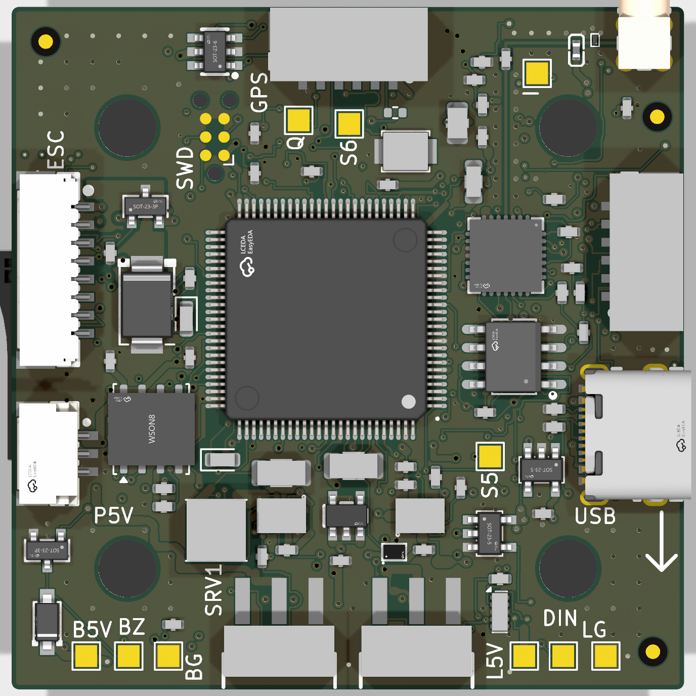
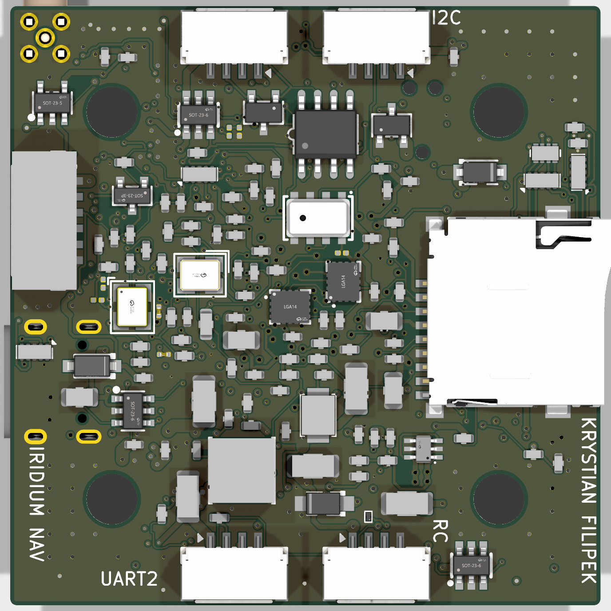
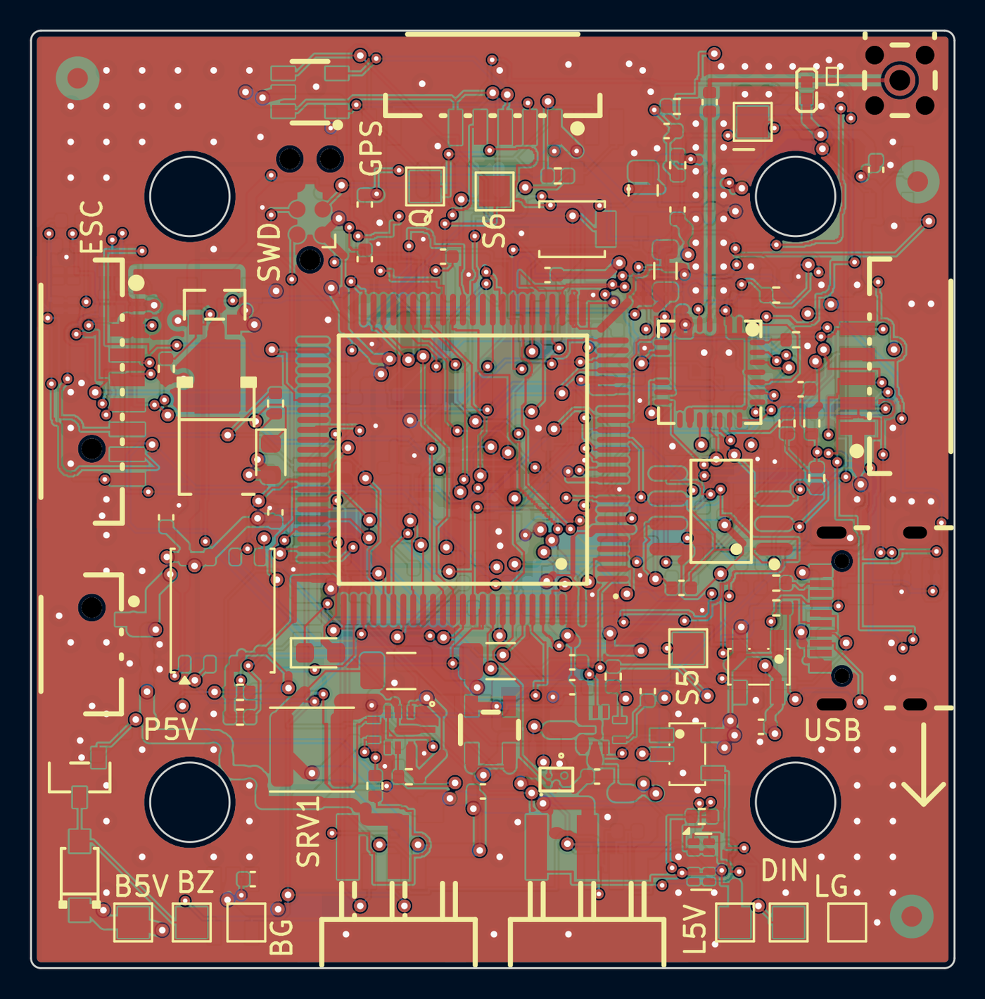

# NAVCORE-SoOP

[](LICENSE)

A 46.5 × 47.2 mm, 6-layer STM32H743 flight controller that navigates without GPS using the Doppler shift of Iridium satellites. It runs ArduPilot with a MatekH743-compatible pinout. Made by Krystian Filipek for my GNSS-denied drone.

<div align="center">





</div>

## Features

### Iridium Navigation
Optical flow and visual-inertial odometry drift without bound over long flights. Iridium NEXT satellites orbit at ~780 km and ~7.5 km/s and transmit continuously at 1616-1626.5 MHz, so the Doppler shift of their bursts gives an absolute position with bounded error (typically 100-200 m) that complements the faster inertial sensors.

- **L-band Receiver** - MAX2112 direct-conversion tuner and OPA2374 baseband filter into the ADCs
- **Antenna Feed** - MMCX port with a current-limited 5 V feed for the active antenna, reported as open, ok or short
- **On-board Navigation** - burst detection, SGP4 orbits and the position solve run on the H743 and feed ArduPilot's EKF as a GPS
- **Spoofing Check** - the real GPS is checked against the Iridium-only fix before it is trusted

### Hardware
| Subsystem | Components |
|-----------|------------|
| MCU | STM32H743VIT6, Cortex-M7 @ 480 MHz, 2 MB flash, 1 MB RAM |
| IMUs | ICM-45686 (SPI1) and ICM-42605 (SPI4) on a separate analogue 3.3 V rail, shared with the tuner |
| Barometer | MS5611 on I2C2 |
| Storage | W25Q128 flash for the orbit catalogue, microSD over SDIO |
| Power | 3S-5S input, TVS and reverse-polarity protection, two 3 A LMR33630 bucks, run to 1.6 A (system) and 2.1 A (payload) by the inductors' rms ratings; L2/L5 saturate at 2.4/2.5 A, below the IC's 4.2 A current limit, so a hard short on a 5 V rail saturates the inductor first and three 3.3 V LDOs |
| Connectors | Latching JST-GH on every cable port, two servo headers, MMCX, USB-C, TC2030 SWD pads |
| Protection | ESD clamp on every cable-facing signal, series resistors on the motor, telemetry, current, lidar and servo lines |

### Layer Stackup
```
F.Cu:   MCU, RF receiver, bucks and LDOs, flash, the edge connectors
In1.Cu: Continuous ground plane
In2.Cu: Mixed signal with GND fill
In3.Cu: Mixed signal with GND fill
In4.Cu: Split power planes (+5V, +5V_PAYLOAD, +3V3, VBAT)
B.Cu:   IMUs, baro, both crystals, CAN, microSD, the underside connectors
```

### On the Drone
30.5 mm stack mount, DShot ESC on `J2`, optical flow on `J14`, lidar on `J11`, companion computer on `J21`, DroneCAN on `J6`

### How It Compares
| | NAVCORE-SoOP | SpeedyBee F405 V4 | Matek H743-SLIM V3 | Pixhawk 6C |
|---|---|---|---|---|
| MCU | STM32H743 | STM32F405 | STM32H743 | STM32H743 + F103 |
| IMUs | ICM-45686 + ICM-42605 | ICM-42688-P | ICM-42688-P + ICM-42605 | ICM-42688-P + BMI088 |
| Input | 3-5S | 3-6S | 2-8S | power module |
| Port ESD | every cable signal | none stated | none stated | none stated |
| Position without GNSS | Iridium Doppler, 100-200 m | none | none | none |

It has no OSD and no 9-12 V video rail, and it takes 5S at most.

## Getting Started

### Prerequisites
- **KiCad 9** to open the board and schematic
- **Python 3** and **ngspice** for the circuit simulations
- **ArduPilot toolchain** for the firmware (`tools/build_firmware.sh` pins Copter-4.7.0)

### Building
1. Clone the repository:
   ```bash
   git clone https://github.com/kfilipekk/iridium_drone.git
   cd iridium_drone
   ```

2. Simulate the analogue blocks (bucks, LDOs, antenna feed, tuner PLL, baseband filter):
   ```bash
   python3 sim/run_suite.py
   ```

3. Build the navigation code and its tests for the host (SGP4, burst detection, the position solve):
   ```bash
   make -C firmware/soop
   ```

4. Build ArduPilot for the board with the SoOP backend:
   ```bash
   bash tools/build_firmware.sh
   ```

### Checking the Board
The checks need KiCad's Python (the `pcbnew` module), and `irdrop.py` needs numpy. Run them from the repository root:
```bash
kicad-cli pcb drc --schematic-parity NAVCORE-SoOP.kicad_pcb
python3 tools/check.py geometry     # acute corners, dangling ends, dead copper, vias in pads
python3 tools/check.py backside     # pins landing under parts on the other side
python3 tools/check.py footprints   # pad counts against JLCPCB's own parts
python3 tools/irdrop.py check       # DC drop and current density on every power rail
python3 tools/fab.py bundle         # gerbers, BOM, CPL and the order sheet, into fab/
```
`--help` on any of them lists the rest.

### Ordering
The JLCPCB files are in `fab/`: the Gerber and drill bundle, BOM, pick-and-place and schematic PDF. Order 6 layers, 1 oz copper inside and out, ENIG, epoxy-filled and capped vias, and assembly on both sides.

## Repository Structure

```
├── NAVCORE-SoOP.kicad_pcb   # PCB
├── NAVCORE-SoOP.kicad_sch   # Schematic, generated from tools/design.py
├── fab/                     # JLCPCB order files
├── firmware/                # ArduPilot hwdef, the SoOP backend and the on-board navigation
├── tools/                   # Design model, schematic and hwdef generators, board checks
├── sim/                     # ngspice simulations of the analogue blocks
├── cad/                     # OpenSCAD airframe, printed mounts and renders
└── libraries/               # Footprint and symbol libraries
```

## Applications

I made this project to explore:
- Navigation from signals of opportunity instead of GPS
- Six-layer mixed-signal PCB design with an RF front end
- ArduPilot drivers and EKF integration
- Simulating the analogue blocks before ordering

## Future Plans

- Bring up Rev E and bench-test the Iridium receive chain with the HC610 antenna
- A downward radar for velocity, which sets how well the Iridium fix holds
- Later: a third IMU, 6S input and a 9-12 V video rail

<div align="center">

Developed by [kfilipekk](https://github.com/kfilipekk)

</div>
